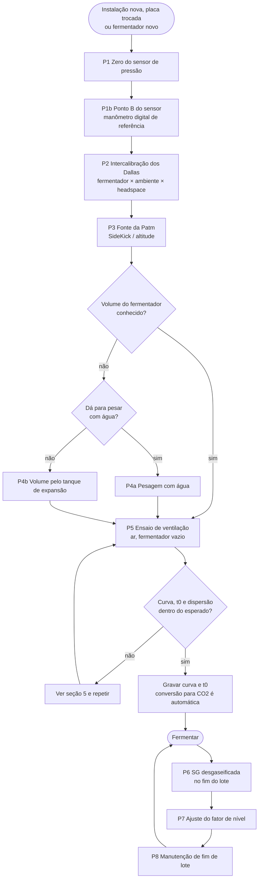

# Povoto: manual de calibração e manutenção

Versão 1 (11/10/2026), método de **ventilação direta** (o vent não usa tanque de expansão; um tanque
simples de volume conhecido só serve para medir o volume do fermentador, P4b).
Firmware: branch `povoto-vent` (`docs/sem-te-plano.md`; detalhes em
`docs/vent.md`, `docs/venting-test.md`, `docs/expansion-tank-volume.md`,
`docs/valve-cleaning.md`, `docs/pressure-sensor-zero.md`,
`docs/atmospheric-pressure.md`). O método antigo com TE está na tag
`te-final-2026-10-11` (binários em `A:\Nuvem\Povoto\Firmware\te-final-2026-10-11`).

Regras gerais:

- Calibração e manutenção só com o equipamento em **OFF**, sem lote ativo e sem
  tarefa aberta.
- **Nenhum botão "Save" da página Calibration antes de analisar os dados.**
  O que vale é o CSV e o histórico.
- Telas e páginas do Povoto são em inglês; os nomes de botões e mensagens
  aparecem aqui como na tela.
- Navegação: `http://<ip>/menu` é o menu (o antigo `/config` redireciona para ele; o ícone de menu do
  dashboard e o QR da TFT abrem o menu). Toda página aberta do menu volta para o menu em Save e em Cancel;
  as ações de rotina da Calibration (Start, Abort, Save zero, Save curve and t0, Save as new FMT volume)
  voltam para `/calibration`.
- Onde ficam os campos: **Fermenter settings** (botão "Fermenter Settings" do menu) — FMT volume, Povoto Number (0–99), Maximum security pressure (acima de 2,0 e até 2,3 bar; o sensor lê bem até esse
  limite), Maximum pressure setpoint (até 2,0 bar e abaixo da pressão de segurança; nenhum setpoint de
  pressão, nem de regra ou da nuvem, passa dele), Target drop of the gauge pressure per vent (1–15%), altitude, Cooling cycle, Heating cycle,
  Thermometers, Backup settings / Restore settings from backups. **User Configuration** — screensaver,
  PIN, brilho, Log interval e "Accept new setpoints and triggered actions from cloud". **Calibration**, em ordem: Pressure sensor (pontos A e B, reta; Point B reading, Sensor
  zero), Fermenter volume, Venting test, Vent (Flow level factor, Effective Venting Exponent, a curva τ(P) com a faixa de validade e o T0, todos editáveis e com os botões "Use last test curve" / "Use last test t0", que só preenchem os campos; vale com Save, entre lotes; a abertura
  mínima de 1,5 s e a queda de segurança de 2× a alvo são fixas), Dissolved CO2 dynamics (Nucleation
  window); um único Save/Cancel no fim grava os campos editáveis, e os eventos de
  calibração ficam no final da página. O **Valve cleaning** fica na página **Control**, junto com o **Valve** (Auto / Open / Closed:
  Open segura a válvula aberta por até 10 min, Closed suspende os reliefs automáticos, mas nunca o de
  segurança) e o **Relief once** (recusado durante rotinas de calibração, com o Valve fora de Auto ou com
  um relief em andamento).
- Arquivos baixados: `PovotoCalibration-<tipo>-FMT<n>-yyyymmddhhmm.csv` (hora local do início do ensaio;
  `nodate` sem NTP). Tipos: `Venting`, `VentingHistory` (todos, hora do download) e `FermenterVolume`;
  `Incomplete-` na frente se baixado antes do fim; eventos: `PovotoCalibration-Events-FMT<n>-<hora>.txt`.
- Anote tudo na folha de registro (seção 6) e guarde os arquivos em
  `A:\Nuvem\Povoto\Calibracoes` (os nomes já trazem o tipo, o FMT e a data e hora).
- Todos os parâmetros de calibração e configuração, o que representam e de onde vêm: seção 9.

## 1. Fluxograma



### Manutenção de fim de lote (P8)


Enquanto o histórico for curto (primeiros lotes), faça a sequência completa em
todo fim de lote. Depois, os ensaios intermediários podem ser dispensados se as
perdas ficarem sempre < 1%.

## 2. Material

- Fermentador vazio, limpo e seco; compressor de ar com regulador.
- Manômetro digital de referência (ponto B do sensor, P1b) e regulador de pressão para um patamar
  estável. O manômetro analógico do fermentador serve só como conferência grosseira.
- Recipiente com água para a intercalibração dos Dallas.
- Só no FMT1: Dallas de 15 cm e poço longo para a porta tri-clamp (headspace).
- Garrafa PET seca com conexão de entrada pelo fundo (testemunha) e silenciador
  de baixa resistência, se for usar.
- Para P4a: balança para a massa de água do fermentador.
- Para P4b: tanque de expansão de 2–50 L, pesado vazio e cheio de água (balança de ~0,1 kg),
  mangueira para a porta A da válvula.
- Para P10: recipiente pressurizável com detergente neutro, água e álcool 70%; ar
  comprimido; mangueira para a porta A; recipiente de dreno.
- Densímetro e termômetro para a SG (P6).

## 3. Procedimentos de calibração

### P1. Zero do sensor de pressão

Quando: instalação, troca de sensor ou placa, antes de P4b e de P5.

Não confie na pressão do status para isso: o firmware corta em 0 qualquer
leitura abaixo do zero gravado, e um zero deslocado para baixo fica escondido. A
rotina usa a corrente bruta do sensor.

1. Modo OFF, fermentador sem lote.
2. Abra o fermentador para a atmosfera com bastante circulação: de preferência
   uma abertura em cima e outra embaixo (sem gradiente de pressão). Espere
   alguns minutos.
3. Calibration → marque que o fermentador está aberto e aperte "Run sensor zero test:". A
   rotina mede a corrente por 5 min (ela não abre válvula nenhuma, e o tempo não é ajustável) e exige a
   placa ligada há pelo menos 30 min para poder gravar.
4. Se aparecer "Unstable reading", a corrente variou demais durante a medição:
   confira as aberturas, se não há gás saindo da cerveja ou do compressor, e
   repita. O botão de gravar não aparece nesse caso.
5. Resultado: diferença entre a corrente medida e o zero gravado, em mA e em
   mbar (sem corte). Dentro de ±2 mbar: não precisa gravar.
6. Fora disso: "Save zero" (desloca os dois pontos da calibração pela mesma
   diferença, sem mudar o ganho). Repita para conferir.
7. Ganho: a conversão é a reta pelos pontos A e B; o ponto B se mede em P1b.

### P1b. Ponto B do sensor de pressão

Quando: instalação, troca de sensor ou placa, depois de P1; se a pressão sem corte do `/getstatus`
divergir do manômetro digital. O Save zero desloca os dois pontos pela mesma diferença: faça P1 antes.

1. Modo OFF, fermentador fechado, sem lote. Ligue o ar comprimido pelo regulador num patamar estável
   acima de 0,5 bar (de preferência perto da pressão de trabalho, 1,5–1,9 bar), com o manômetro digital
   de referência no mesmo ponto.
2. Espere **5 min** com a pressão estável, para a temperatura do gás assentar.
3. Calibration → "Point B reading": digite a pressão do manômetro digital (3 casas), marque que a
   pressão está estável há 5 min e aperte "Run point B reading". A rotina mede a corrente por 2 min
   (não abre válvula nenhuma, o tempo não é ajustável) e exige a placa ligada há pelo menos 30 min
   para poder gravar.
4. Resultado: corrente média, desvio padrão, amplitude das médias de 10 s e tendência (os mesmos
   critérios do zero: 1, 1 e 0,5 mbar), a pressão que a reta gravada lê nessa corrente contra a
   referência (em mbar) e a diferença da corrente em relação ao ponto B gravado.
5. "Unstable reading": a pressão não estava estável (vazamento, regulador oscilando, temperatura ainda
   assentando) ou saiu gás. Corrija e repita; o botão de gravar não aparece.
6. "Save point B": a pressão de referência e a corrente média passam a ser o ponto B. Nada é gravado sem
   o botão; o mesmo resultado não é gravado duas vezes, e a gravação entra nos eventos de calibração.
7. Confira repetindo a leitura noutra pressão (por exemplo 1,0 bar): a diferença em mbar entre a reta e o
   manômetro deve ficar pequena. O erro de ganho que sobrar é o do próprio manômetro de referência.

### P2. Intercalibração dos Dallas (fermentador × ambiente × headspace)

Quando: instalação, troca de sensor; depois, uma vez por ano.

1. Coloque os sensores juntos num recipiente com água em temperatura ambiente
   (ou lado a lado, à sombra, por 1 h). O do headspace (só no FMT1) pode ser
   intercalibrado antes de ir para o poço.
2. Espere 30 min e anote as leituras por 10 min.
3. Diferença média esperada: ~0,2 °C (o ±0,5 °C do datasheet é 3σ). Registre a
   diferença. Mais de 0,7 °C: suspeite do sensor (sondas baratas podem ter chips
   não originais) e troque.

### P3. Fonte da pressão atmosférica

Prioridade: SideKick (broadcast `'A'`, um por site; o SideKick precisa do BMP581, nos
pinos SDA 32 / SCL 33) → altitude configurada. O Povoto não tem barômetro próprio.

1. Confira no `/getstatus` a fonte em uso e o valor (hPa).
2. Com duas fontes válidas, a diferença entre elas deve ficar em poucos hPa.
3. Confira a **altitude** na página Fermenter settings mesmo com o SideKick (é o fallback).
   Não mude a altitude no meio de um lote.

### P4a. Volume do fermentador por pesagem

Quando: fermentador novo. O volume não muda depois. Site principal: 129,6 L.

1. Pese a água que enche o fermentador até a tampa (ou pese o fermentador vazio e
   cheio). Volume = massa / densidade da água na temperatura medida.
2. Grave o FMT volume (Settings).

### P4b. Volume do fermentador pelo tanque de expansão

Quando: fermentador grande demais para pesar, ou para conferir a pesagem.

1. Tenha um tanque de expansão de volume conhecido V_E (pesado vazio e cheio de água: V_E = massa
   da água / densidade). Esvazie e seque.
2. Ligue o tanque na porta A da válvula, sem válvula de retenção na saída de ventilação.
3. P1 (zero) antes.
4. Tanque e fermentador à sombra, no mesmo lugar. O tanque se acerta com o ambiente sozinho; o
   fermentador (isolado, pressurizado com ar quente do compressor) fica com temperatura própria:
   o cálculo usa as duas.
5. Pressurize o fermentador a ~2,0 bar, espere pelo menos 15 min e aperte Start em Calibration → "Fermenter
   volume" (o campo traz o último volume do tanque; o número de reliefs é calculado e mostrado).
   A rotina leva 2–3 h e desce sozinha até ~0,5 bar: espera a pressão estável, abre a válvula
   para o tanque, espera de novo, fecha e ventila o tanque.
6. Resultado: V_F por relief e a média e o desvio dos reliefs estáveis ("n of m reliefs used"),
   com o FMT volume configurado ao lado. Reliefs instáveis ficam fora da média (e no CSV).
7. Aceito o resultado (pelo menos 2 reliefs estáveis), aperte "Save as new FMT volume" (pede
   confirmação; grava o FMT volume e um evento de calibração). O CSV fica em
   `PovotoCalibration-FermenterVolume-FMT<n>-yyyymmddhhmm.csv`.
8. Para conferir, repita partindo de ~1,2 bar: o volume deve ser o mesmo dentro de ~0,3–0,5%.

### P5. Ensaio de ventilação

Quando: calibração inicial; manutenção de fim de lote (P8); válvula nova;
mudança na saída (garrafa, silenciador); qualquer suspeita sobre a válvula.

1. Fermentador **vazio**, ar, volume correto no Settings, OFF.
2. Porta A para a atmosfera pela garrafa testemunha (montagem de uso).
3. Pressurize **acima da maior pressão de fermentação mais a margem do dente de
   serra** (~3%): para setpoint de 1,9 bar, ~2,05–2,10 bar. O sensor é certificado
   até 2 bar, mas mede razoavelmente um pouco acima. Espere ~15 min.
4. Calibration → "Venting test" (sempre ar e o FMT volume do Settings); escolha a **etiqueta** (`as-is` /
   `muffler-cleaned` / `valve-cleaned` / `new-valve` / `after-cleaning-cycle`).
5. O ensaio alterna durações (2, 0,5, 8, 1, 4, 2 s) em patamares do topo até
   **abaixo da menor pressão de fermentação usada** (com fermentações a 0,3 bar,
   o último patamar fica em ~0,25 bar), com uma abertura longa entre eles; mede o tempo real
   de cada abertura e grava cada liberação no histórico (~55–65 min). Não mexa
   no equipamento. Durante o ensaio, "Current test CSV" baixa as liberações já concluídas
   (arquivo `Incomplete-...`).
6. Resultado: curva τ(P) cúbica, t0 ± erro padrão, resíduo de forma, deriva
   (por patamar) ± erro padrão, e a diferença contra a curva de referência e a
   gravada em 1,8 / 1,2 / 0,8 bar. `python tests/venting_fit.py arquivo.csv`
   refaz o ajuste fora da placa.
7. Calibração: baixe o CSV, mande para análise e só então grave a curva e o t0
   ("Save curve and t0"); na primeira calibração, grave também a curva de
   referência ("Save as reference curve"). Manutenção: não grave nada; o
   histórico é o resultado.

**Faixa calibrada.** A curva só vale entre a maior e a menor pressão do ensaio.
Um vent fora dessa faixa usa o valor da ponta e fica marcado no log. Na ponta
alta o erro é pequeno (no sônico o τ varia devagar); na ponta baixa (abaixo de
~0,4 bar, regime subsônico) o τ cresce rápido e o valor da ponta superestima a
vazão. Se for fermentar fora da faixa calibrada, refaça o P5 cobrindo-a antes do
lote.

A conversão ar → CO2 (teórica, em função da pressão) e o fator de
compressibilidade do CO2 são aplicados pelo firmware; não há ensaio com CO2.

### P6. SG desgaseificada

Quando: fim de cada lote (obrigatório) e, se quiser, em pontos intermediários com
a fermentação estável (pressão e temperatura estáveis há horas).

1. Retire ~250 mL, desgaseifique (passar várias vezes entre dois copos ou agitar
   até parar de formar espuma).
2. Meça com densímetro e corrija pela temperatura da amostra.
3. Anote data/hora, SG medida e a SG calculada pelo Povoto no mesmo momento.
4. Incerteza típica: ±0,5–1 ponto.

### P7. Ajuste do fator de nível

Cada 1% de CO2 contado a menos deixa a SG calculada ~0,4 ponto acima da medida
(cerveja 1,050 → 1,010).

```
correção (%) ≈ (SG calculada − SG medida) [pontos] / 0,4
fator novo = fator atual × (1 + correção)
```

Exemplo: calculada 1,012, medida 1,010 → 2 pontos → +5%.

- Não aplique a correção de um lote só por inteiro: use a média dos lotes (cada
  leitura vale ±1,5–2,5%). Sugestão: até 3 lotes, média simples; depois, média
  dos últimos 5.
- Não use leituras feitas em transição de pressão ou temperatura, nem logo depois
  de dry hop.
- Só entre lotes. Campo "Flow level factor" da página Calibration.

### P7b. Janela de nucleação (dry hop)

Quando: depois de cada dry hop ou dynamic hop, para decidir o campo "Nucleation window"
(Calibration, seção "Dissolved CO2 dynamics"; padrão **30 min**; placas com valor já gravado o mantêm).

A janela vale para as quatro tasks que a usam: **Gas, Liquid, Dry hopping e Dynamic hopping**. Com
30 min, depois de Gas e Liquid o dissolvido também fica parado e o headspace não é medido por 30 min
(a estimativa abaixo só roda para Dry hopping e Dynamic hopping).

1. O firmware estima a janela sozinho (docs/dissolved-co2.md, seção 8) e **não** altera o campo.
2. No início da task ele traça uma reta sobre os ~70 min de G (fase gasosa) anteriores; depois do fim da
   task observa 3 h em blocos de 10 min. Não mexa em setpoints (pressão ou temperatura), não rode outra
   task e não reinicie a placa nas 3 h; não deixe o fermentador aberto (pressão < 0,1 bar) durante a task.
3. 3 h depois do fim da task, o evento `nucleation-estimate` aparece em Calibration → "Calibration
   events" (e na linha "Last" abaixo do campo). Compare `EstimatedWindowMin` (resolução de 10 min) com
   `ConfiguredWindowMin`; `ExcessMolDuringTask` e `ExcessMolInsideWindow` com `ModelDissolvedDropMol`; e
   `ExcessMolAfterWindow` (que carrega o desvio da reta extrapolada por 3 h) como ordem de grandeza.
   `DissolvedCO2Mode` diz se o modelo mexeu em D (só no half-life e no armado).
4. Só vale com `Quality=ok`. `noisy baseline` (maior bloco < 4·σ_bloco), `not settled` (não assentou em
   3 h), `vented`, `no baseline` (menos de 60 amostras ou gás adicionado na referência) e `interrupted`
   não dão estimativa.
5. Decida o valor depois de vários lotes e grave em "Nucleation window" (Save). Sem faixa de validação.

## 4. Procedimentos de manutenção

### P8. Fim de lote

Siga o segundo fluxograma da seção 1.

### P9. Silenciador

1. Retire o silenciador da garrafa testemunha (e o da porta R, se houver).
2. Lave com detergente neutro e água morna; álcool 70% se houver resina.
3. Seque com ar comprimido. Recoloque.

### P10. Ciclo de limpeza da válvula

1. Modo OFF.
2. Solte a porta **P** do fermentador e leve-a ao dreno. Retire o silenciador da
   porta **R** e leve-a ao dreno.
3. Ligue o líquido pressurizado (alguns décimos de bar) **só na porta A**.
4. Control → "Valve cleaning". A válvula alterna energizada (A→P)
   e desenergizada (A→R), 2 s + 2 s, pelo tempo que você escolher (padrão 4 min); o LED de venting
   fica aceso com a válvula fechada. O programa não controla as fases: você troca o líquido e aperta
   "Start valve cleaning" a cada rodada.
5. Rodadas sugeridas, trocando o líquido em A antes de cada uma:
   1. detergente neutro;
   2. água;
   3. álcool 70%;
   4. ar comprimido (secagem).
6. Na primeira vez, confira que a válvula comuta com A pressurizada (o líquido
   sai alternadamente por P e por R).
7. Religue P ao fermentador, recoloque o silenciador.

Não use soda nem Vanish em pó (corpo de alumínio). Não molhe a bobina.

### P11. Garrafa testemunha

- Garrafa PET **seca**, gás entrando pelo fundo, topo bem aberto (silenciador de
  baixa resistência no topo, se houver). Nunca com água.
- Inspecione a cada fim de lote. Qualquer líquido ou depósito: registre e veja a
  seção 5.

## 5. O que fazer se o resultado sair do esperado

| Sintoma | Provável causa | Ação |
|---|---|---|
| P1: "Unstable reading" | fermentador mal aberto, gás saindo, sensor derivando | mais aberturas (em cima e embaixo), esperar, repetir; se persistir, verificar o sensor |
| Zero do sensor fora de ±2 mbar | deriva do sensor ou do shunt | gravar o zero (P1); se voltar a sair entre lotes, verificar hardware (INA226, shunt, fonte do 4–20 mA) |
| Ganho fora (pressão sem corte muito diferente do manômetro analógico) | pontos A e B da calibração desatualizados | refazer o zero (P1) e o ponto B (P1b) |
| Diferença dos Dallas > 0,7 °C | sensor ruim ou não original | trocar e repetir P2 |
| Headspace (FMT1): leitura muda muito ao puxar a sonda 3–4 cm | condução pela haste/poço | isolar melhor a conexão por fora; registrar e avaliar se vale manter atribuído |
| P4b: volume muda com a pressão inicial | offset do sensor ou pressão residual no tanque | repetir P1; ventilar o tanque por mais tempo; conferir retenção na saída |
| P4b: dispersão entre reliefs > 0,5% | pressão não estabilizada | esperar mais antes de P1/P2 |
| P5: erro padrão do t0 > 5 ms, ou deriva maior que 2× o seu erro padrão | solenoide ou fonte da bobina instável | conferir a tensão; trocar a válvula |
| P5: resíduo de forma > 1% | leituras sem estabilizar, ou forma diferente | repetir com espera maior; mandar para análise (com ruído de leitura normal, ~0,15 mbar, ele fica em ~0,5%) |
| Vents marcados fora da faixa calibrada no log | fermentação acima ou abaixo das pressões do último P5 | refazer o P5 cobrindo a faixa (topo ≥ setpoint máximo + 3%; base abaixo do menor setpoint) |
| P5: curva > 3% abaixo da referência | sujeira na válvula ou no silenciador | P9 e P10 e repetir; se não voltar, trocar a válvula e registrar `new-valve` |
| P5: perda < 3% mas volta só com a limpeza | sujeira por lote | manter P10 em todo fim de lote |
| Líquido na garrafa testemunha | krausen chegando à válvula | registrar; avaliar separador antes da válvula; P10 |
| P7: correção > 5% num lote | leitura de SG ou condição atípica | não aplicar; medir de novo no próximo lote |
| Alarme de vent abaixo do esperado (2 vents seguidos com a queda < 80% da esperada) | válvula não abriu, saída obstruída, mudança brusca de volume (líquido adicionado fora de uma task) | verificar a montagem com o equipamento em OFF; esses vents foram contados pelo lado do fermentador e ficaram fora da média de 24 h e da EMA. Um vent isolado abaixo de 80% só fica marcado no log (`ReliefCheck` = partial / no-effect) |
| `HeadSpaceDaily` subindo devagar, sem alarme | sujeira gradual na válvula ou no silenciador (a razão do vent só enxerga mudanças bruscas, pois a referência vem do próprio modelo de vazão) | P8: ensaio de ventilação de fim de lote e comparação com a curva de referência |
| Alarme de válvula presa aberta | êmbolo preso, sujeira no assento, falha no acionamento | fechar a linha manualmente; P10 ou trocar a válvula. O alarme apaga sozinho quando a pressão volta a subir; o bipe espaça (1 por minuto nos primeiros 10 min, depois a cada 15 min e a cada hora) |

## 6. Folha de registro

Uma linha por evento. Guarde junto com os CSV.

| Data | Lote | Procedimento | Etiqueta | Fonte Patm | Resultado | Gravado? | Obs. |
|---|---|---|---|---|---|---|---|
| | | | | | | | |

## 7. Quando refazer

| Procedimento | Quando |
|---|---|
| P1 Zero | instalação; troca de sensor/placa; antes de P4b e P5 de calibração; se a pressão em repouso não for 0 |
| P1b Ponto B | instalação; troca de sensor/placa (depois do zero); se divergir do manômetro digital |
| P2 Dallas | instalação; troca de sensor; anual |
| P3 Patm | instalação; troca de placa ou de SideKick |
| P4 Volume | fermentador novo; alteração na tubulação |
| P5 calibração | instalação; válvula nova; mudança na saída (garrafa, silenciador) |
| P5 manutenção | fim de cada lote (sequência P8) |
| P6/P7 | fim de cada lote |
| P7b Janela de nucleação | depois de cada dry hop / dynamic hop (informativo; o campo só muda por decisão sua) |
| P9/P10/P11 | fim de cada lote |

## 8. Visita de migração do TE para a ventilação direta

Uma visita, no intervalo entre lotes, ~3–4 h (a maior parte é o equipamento
rodando sozinho).

**Antes de sair de casa**
- [ ] Firmware novo revisado; binário da tag `te-final-2026-10-11` guardado (fallback;
      `A:\Nuvem\Povoto\Firmware\te-final-2026-10-11`, com `littlefs.bin` das páginas).
- [ ] Backup das configurações do Povoto (Settings → "Backup settings", `povoto-settings.json`; volta com
      "Restore settings from backups").
- [ ] Garrafa PET preparada (entrada pelo fundo, topo aberto), conexões para a
      porta A, silenciador/filtro para a porta R.
- [ ] Compressor no local, recipiente com água para os Dallas; para o FMT1,
      Dallas de 15 cm, poço longo e material para isolar a conexão por fora.
- [ ] Este manual e a folha de registro.

**No local**
1. [ ] Lote anterior encerrado; fermentador vazio, limpo e seco; modo OFF.
2. [ ] OTA do firmware novo; conferir versão, Settings preservados e `/getstatus`.
3. [ ] Retirar o TE da porta A e o termômetro Dallas do TE e **guardá-los no
       local**; instalar a garrafa testemunha na porta A e o silenciador/filtro
       na porta R.
4. [ ] P2 Intercalibração dos Dallas (fermentador, ambiente e, no FMT1, o do
       headspace antes de instalá-lo).
5. [ ] Só no FMT1: instalar o poço pela porta tri-clamp mais próxima da saída
       do gás para a válvula, com a ponta alguns cm abaixo da tampa (na região
       de onde sai o gás dos vents, não no fundo do headspace; sem alcançar o
       líquido nem o krausen) e a sonda no fundo do poço;
       isolar a conexão por fora; Settings → Thermometers → "Rescan bus" e
       atribuir o papel "Headspace". Em todos: conferir que fermentador e
       ambiente continuam atribuídos.
6. [ ] P1 Zero do sensor e P1b ponto B com o manômetro digital.
7. [ ] P3 Conferir fonte da Patm e altitude.
8. [ ] P5 Ensaio de ventilação com ar, etiqueta `new-valve` ou `as-is`.
9. [ ] Baixar o CSV e mandar para análise. **Não gravar curva nem t0 ainda.**
10. [ ] Anotar tudo na folha de registro.

**Depois da visita, antes do próximo lote**
- [ ] Análise do ensaio (à distância): curva cúbica, t0, dispersão, deriva.
- [ ] Gravar curva e t0 (botão), fator de nível = 1.
- [ ] Iniciar o lote; programar leituras de SG desgaseificada no fim.

**Fallback (se necessário, entre lotes)**
- [ ] OTA da tag `te-final-2026-10-11` (firmware e páginas), religar o TE na
      porta A e o Dallas do TE, conferir kCO2, Vr e o papel do Dallas do TE no
      Settings (as chaves ficaram gravadas).

## 9. Parâmetros de calibração e configuração

O que cada parâmetro representa e de onde vem o valor. "Onde": página do Povoto (Settings = Fermenter
Settings; Calibration; User Configuration). A coluna "Origem" cita o procedimento (P1, P4a...) ou a decisão
que define o valor.

### Sensor de pressão (Calibration → Pressure sensor)

| Parâmetro | O que representa | Origem |
|---|---|---|
| Ponto A: pressão 0 bar, corrente (mA) | Corrente do transmissor com o fermentador aberto à atmosfera (pressão manométrica zero) | Rotina Sensor zero, 5 min, botão "Save zero" (P1); ou "Use actual" |
| Ponto B: pressão (bar) | Pressão de referência em que se mediu a corrente do ponto B | Manômetro digital de referência, digitada na rotina "Point B reading" (P1b) |
| Ponto B: corrente (mA) | Corrente média do transmissor nessa pressão | Rotina "Point B reading", 2 min, botão "Save point B" (P1b); ou "Use actual" |
| Maximum security pressure | Pressão acima da qual a válvula abre sempre, com qualquer opção do Valve | Decisão de projeto: acima de 2,0 e até 2,3 bar, o limite em que o sensor de 0 a 2 bar lê bem |
| Maximum pressure setpoint | Maior setpoint de pressão aceito (página, regras e nuvem) | Decisão do operador: até 2,0 bar e abaixo da pressão de segurança |

### Fermentador e local (Settings)

| Parâmetro | O que representa | Origem |
|---|---|---|
| FMT Total Volume (L) | Volume interno total do fermentador; o headspace é esse volume menos a cerveja | Pesagem com água (P4a) ou rotina "Fermenter volume" com o tanque de expansão (P4b, "Save as new FMT volume") |
| Expansion tank volume (L), campo da rotina Fermenter volume | Volume do tanque de referência usado só nessa rotina | Tanque pesado vazio e cheio de água |
| Altitude (m) | Altitude do local, usada para a pressão atmosférica quando o SideKick não a fornece | Altitude do local |
| Povoto Number | Número do equipamento (0 a 99; no cloud, site × 100 + número) | Definido na instalação |
| Debug mode | Placa de bancada: sensores simulados, tempos curtos, TFT girado 180° | Decisão do operador |

### Vent (Calibration → Vent, e Settings)

| Parâmetro | O que representa | Origem |
|---|---|---|
| Target drop per vent (%) (Settings) | Queda alvo da pressão manométrica em cada relief; define o dente de serra em torno do setpoint (relief em setpoint/√(1 − queda)) | Decisão de projeto, padrão 6% |
| Flow curve: a0, a1, a2, a3 | Coeficientes da cúbica τ(P) = a0 + a1·P + a2·P² + a3·P³ (s): constante de tempo da pressão absoluta de 100 L de ar a 20 °C, com P manométrica em bar. O firmware a escala para o volume de headspace e a temperatura do gás | Ajuste de mínimos quadrados (pesos P_abs²) das liberações do ensaio de ventilação, com ar e o fermentador vazio (P5); "Save curve and t0", "Use last test curve" ou digitados |
| Flow curve: valid from / to (bar) | Faixa de pressão coberta pelo ensaio; fora dela vale o valor da ponta (acima) ou a escala do bocal (abaixo) | Ensaio de ventilação (pressão mais alta e mais baixa medidas) |
| T0 (ms) | Atraso mecânico da válvula entre o comando e o gás sair; é descontado do tempo aberto | Intercepto do ajuste do ensaio de ventilação (P5), "Use last test t0" |
| Reference curve | Curva fixa de comparação, para medir a perda de vazão (sujeira) em 1,8 / 1,2 / 0,8 bar | Primeiro ensaio de calibração, "Save as reference curve" |
| Flow level factor | Multiplicador (1,0 = teoria) da vazão molar de CO2 calculada. Representa o desvio entre a vazão real de CO2 e a teórica (conversão ar → CO2 do bocal ideal, Z do CO2 e curva medida com ar) | Ajustado entre lotes pela SG desgaseificada medida (P6 e P7) |
| Effective Venting Exponent | Expoente politrópico n da expansão do gás durante a abertura (1 = isotérmico, 1,29 ≈ adiabático do CO2); entra no resfriamento durante o vent e na pressão assentada logo após o fechamento | Ajustado nos dados do lote 160 (recuperação medida na média diária, τ ≈ 30 s); padrão 1,29, não mudar sem dados novos |
| Abertura mínima, queda de segurança, teto de abertura | 1,5 s; 2 × a queda alvo; 30 s | Fixos no código (docs/vent.md) |

### Temperatura (Settings)

| Parâmetro | O que representa | Origem |
|---|---|---|
| Thermometers: fermentador, ambiente, headspace | Qual sonda Dallas tem cada papel; a do headspace é opcional | "Rescan bus" e atribuição; intercalibração das sondas (P2) |
| Cooling cycle: tempo ligado e de descanso em 20, 10 e 0 °C | Cadência do chiller conforme a temperatura | Ajustado ao equipamento e à instalação |
| Heating cycle: habilitar, tempo ligado e de descanso | Cadência do aquecedor | Ajustado ao equipamento e à instalação |

### CO2 dissolvido (Calibration)

| Parâmetro | O que representa | Origem |
|---|---|---|
| Nucleation window (min) | Tempo, depois de Gas, Liquid, Dry hopping e Dynamic hopping, em que o headspace não é medido e o dissolvido fica parado | Padrão 30 min; decidido depois de vários lotes pela estimativa do firmware (P7b) |

### Preferências (User Configuration)

| Parâmetro | O que representa | Origem |
|---|---|---|
| Screensaver Time, Keypad PIN, Display Brightness, LED Brightness | Comportamento da TFT e do LED RGB | Preferência do operador |
| Accept new setpoints and triggered actions from cloud | Se o Povoto aplica alterações vindas do cloud | Decisão do operador |
| Google Sheets Datalog (liga/desliga e pasta), Log interval | Destino e frequência do registro | Decisão do operador |
