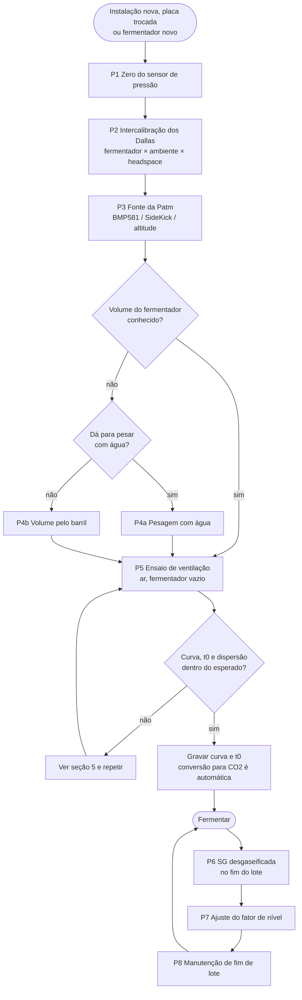
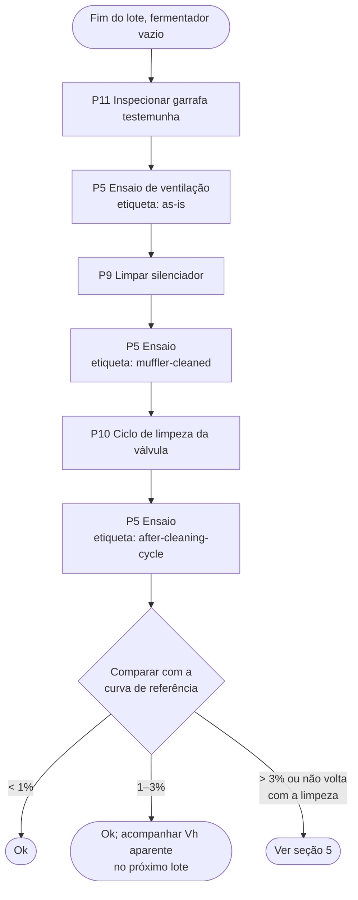

# Povoto: manual de calibração e manutenção

Versão 1 (11/10/2026), método de **ventilação direta** (sem tanque de expansão).
Firmware: branch `povoto-vent` (`docs/sem-te-plano.md`; detalhes em
`docs/vent.md`, `docs/venting-test.md`, `docs/keg-volume.md`,
`docs/valve-cleaning.md`, `docs/pressure-sensor-zero.md`,
`docs/atmospheric-pressure.md`). O método antigo com TE está na tag
`te-final-2026-10-11` (binários em `A:\Nuvem\Povoto\Firmware\te-final-2026-10-11`).

Regras gerais:

- Calibração e manutenção só com o equipamento em **OFF**, sem lote ativo e sem
  tarefa aberta.
- **Nenhum botão "Save" da página Calibration antes de analisar os dados.**
  O que vale é o CSV e o histórico.
- Telas e páginas do Povoto são em inglês; os nomes de botões e mensagens
  aparecem aqui como na tela.
- Anote tudo na folha de registro (seção 6) e guarde os arquivos em
  `A:\Nuvem\Povoto\Calibracoes` com a data na frente (`AAAA-MM-DD_...`).

## 1. Fluxograma



### Manutenção de fim de lote (P8)



Enquanto o histórico for curto (primeiros lotes), faça a sequência completa em
todo fim de lote. Depois, os ensaios intermediários podem ser dispensados se as
perdas ficarem sempre < 1%.

## 2. Material

- Fermentador vazio, limpo e seco; compressor de ar com regulador.
- Manômetro analógico do fermentador (conferência grosseira do ganho do
  sensor).
- Recipiente com água para a intercalibração dos Dallas.
- Só no FMT1: Dallas de 15 cm e poço longo para a porta tri-clamp (headspace).
- Garrafa PET seca com conexão de entrada pelo fundo (testemunha) e silenciador
  de baixa resistência, se for usar.
- Para P4a: balança para a massa de água do fermentador.
- Para P4b: barril de 19–50 L, pesado vazio e cheio de água (balança de ~0,1 kg),
  mangueira para a porta A da válvula.
- Para P10: recipiente pressurizável com detergente neutro, água e álcool 70%; ar
  comprimido; mangueira para a porta A; recipiente de dreno.
- Densímetro e termômetro para a SG (P6).

## 3. Procedimentos de calibração

### P1. Zero do sensor de pressão

Quando: instalação, troca de sensor ou placa, antes de P4b e de P5.

Não confie na pressão do status para isso: o firmware corta em 0 qualquer
leitura abaixo do zero gravado, e um zero deslocado para baixo fica escondido. A
rotina usa a corrente bruta do sensor.

1. Modo OFF, fermentador sem lote.
2. Abra o fermentador para a atmosfera com bastante circulação: de preferência
   uma abertura em cima e outra embaixo (sem gradiente de pressão). Espere
   alguns minutos.
3. Calibration → "Sensor zero" e confirme que o fermentador está aberto. A
   rotina mede a corrente por 5 min (ela não abre válvula nenhuma) e exige a
   placa ligada há pelo menos 30 min.
4. Se aparecer "Unstable reading", a corrente variou demais durante a medição:
   confira as aberturas, se não há gás saindo da cerveja ou do compressor, e
   repita. O botão de gravar não aparece nesse caso.
5. Resultado: diferença entre a corrente medida e o zero gravado, em mA e em
   mbar (sem corte). Dentro de ±2 mbar: não precisa gravar.
6. Fora disso: "Save zero" (desloca os três pontos da calibração pela mesma
   diferença, sem mudar o ganho). Repita para conferir.
7. Ganho (conferência grosseira): feche o fermentador, pressurize a ~1,9 bar e
   compare a pressão sem corte mostrada na mesma página com o manômetro
   analógico do fermentador. Diferença maior que a incerteza de leitura dele
   (alguns %): registre (ver seção 5).

### P2. Intercalibração dos Dallas (fermentador × ambiente × headspace)

Quando: instalação, troca de sensor; depois, uma vez por ano.

1. Coloque os sensores juntos num recipiente com água em temperatura ambiente
   (ou lado a lado, à sombra, por 1 h). O do headspace (só no FMT1) pode ser
   intercalibrado antes de ir para o poço.
2. Espere 30 min e anote as leituras por 10 min.
3. Diferença média esperada: ~0,2 °C (o ±0,5 °C do datasheet é 3σ). Registre a
   diferença. Mais de 0,7 °C: suspeite do sensor (sondas baratas podem ter chips
   não originais) e troque.

### P3. Fonte da pressão atmosférica

Prioridade: BMP581 no Povoto → SideKick (broadcast `'A'`, um por site; o
SideKick precisa do BMP581 nos pinos 27/14) → altitude configurada.

1. Confira no `/getstatus` a fonte em uso e o valor (hPa).
2. Com duas fontes válidas, a diferença entre elas deve ficar em poucos hPa.
3. Confira a **altitude** na página Settings mesmo com barômetro (é o fallback).
   Não mude a altitude no meio de um lote.

### P4a. Volume do fermentador por pesagem

Quando: fermentador novo. O volume não muda depois. Site principal: 129,6 L.

1. Pese a água que enche o fermentador até a tampa (ou pese o fermentador vazio e
   cheio). Volume = massa / densidade da água na temperatura medida.
2. Grave o FMT volume (Settings).

### P4b. Volume do fermentador pelo barril

Quando: fermentador grande demais para pesar, ou para conferir a pesagem.

1. Pese o barril vazio e cheio de água: V_E = massa da água / densidade. Esvazie e
   seque.
2. Ligue o barril na porta A da válvula, sem válvula de retenção na saída de
   ventilação.
3. P1 (zero) antes.
4. Barril e fermentador à sombra, no mesmo lugar. O barril se acerta com o
   ambiente sozinho; o fermentador (isolado, pressurizado com ar quente do
   compressor) fica com temperatura própria: o cálculo usa as duas.
5. Pressurize o fermentador a ~1,9 bar e espere a pressão estabilizar
   (< 0,1 mbar/min).
6. Calibration → "Keg volume" (volume do barril e número de reliefs, 4): ela
   abre a válvula até equalizar, espera estabilizar, lê P2 e as temperaturas,
   ventila o barril e repete. Nada é gravado: o volume aceito vai para o FMT
   volume na página Settings.
7. Repita partindo de ~1,2 bar e de ~0,6 bar.
8. Resultado: V_F por relief e média. Os três níveis de pressão devem dar o mesmo
   volume dentro de ~0,3–0,5%.

### P5. Ensaio de ventilação

Quando: calibração inicial; manutenção de fim de lote (P8); válvula nova;
mudança na saída (garrafa, silenciador); qualquer suspeita sobre a válvula.

1. Fermentador **vazio**, ar, volume correto no Settings, OFF.
2. Porta A para a atmosfera pela garrafa testemunha (montagem de uso).
3. Pressurize **acima da maior pressão de fermentação mais a margem do dente de
   serra** (~3%): para setpoint de 1,9 bar, ~2,0–2,05 bar. O sensor é certificado
   até 2 bar, mas mede razoavelmente um pouco acima. Espere ~10 min.
4. Calibration → "Venting test"; escolha a **etiqueta** (`as-is` /
   `muffler-cleaned` / `valve-cleaned` / `new-valve` / `after-cleaning-cycle`).
5. O ensaio alterna durações (2, 0,5, 8, 1, 4, 2 s) em patamares do topo até
   **abaixo da menor pressão de fermentação usada** (com fermentações a 0,3 bar,
   o último patamar fica em ~0,25 bar), com uma abertura longa entre eles; mede o tempo real
   de cada abertura e grava cada liberação no histórico (~55–65 min). Não mexa
   no equipamento.
6. Resultado: curva τ(P) cúbica, t0 ± erro padrão, qui-quadrado reduzido, deriva
   (por patamar) ± erro padrão, e a diferença contra a curva de referência e a
   gravada em 1,8 / 1,2 / 0,8 bar. `python tests/venting_fit.py arquivo.csv`
   refaz o ajuste fora da placa.
7. Calibração: baixe o CSV, mande para análise e só então grave a curva e o t0
   ("Save curve and t0"); na primeira calibração, grave também a curva de
   referência ("Save as reference curve"). Manutenção: não grave nada; o
   histórico é o resultado.

**Faixa calibrada.** A curva só vale entre a maior e a menor pressão do ensaio.
Um vent fora dessa faixa usa o valor da ponta e fica marcado no log. Na ponta
alta o erro é pequeno (no sônico o τ varia devagar); na ponta baixa (abaixo de
~0,4 bar, regime subsônico) o τ cresce rápido e o valor da ponta superestima a
vazão. Se for fermentar fora da faixa calibrada, refaça o P5 cobrindo-a antes do
lote.

A conversão ar → CO2 (teórica, em função da pressão) e o fator de
compressibilidade do CO2 são aplicados pelo firmware; não há ensaio com CO2.

### P6. SG desgaseificada

Quando: fim de cada lote (obrigatório) e, se quiser, em pontos intermediários com
a fermentação estável (pressão e temperatura estáveis há horas).

1. Retire ~250 mL, desgaseifique (passar várias vezes entre dois copos ou agitar
   até parar de formar espuma).
2. Meça com densímetro e corrija pela temperatura da amostra.
3. Anote data/hora, SG medida e a SG calculada pelo Povoto no mesmo momento.
4. Incerteza típica: ±0,5–1 ponto.

### P7. Ajuste do fator de nível

Cada 1% de CO2 contado a menos deixa a SG calculada ~0,4 ponto acima da medida
(cerveja 1,050 → 1,010).

```
correção (%) ≈ (SG calculada − SG medida) [pontos] / 0,4
fator novo = fator atual × (1 + correção)
```

Exemplo: calculada 1,012, medida 1,010 → 2 pontos → +5%.

- Não aplique a correção de um lote só por inteiro: use a média dos lotes (cada
  leitura vale ±1,5–2,5%). Sugestão: até 3 lotes, média simples; depois, média
  dos últimos 5.
- Não use leituras feitas em transição de pressão ou temperatura, nem logo depois
  de dry hop.
- Só entre lotes. Campo "Flow level factor" da página Calibration.

## 4. Procedimentos de manutenção

### P8. Fim de lote

Siga o segundo fluxograma da seção 1.

### P9. Silenciador

1. Retire o silenciador da garrafa testemunha (e o da porta R, se houver).
2. Lave com detergente neutro e água morna; álcool 70% se houver resina.
3. Seque com ar comprimido. Recoloque.

### P10. Ciclo de limpeza da válvula

1. Modo OFF.
2. Solte a porta **P** do fermentador e leve-a ao dreno. Retire o silenciador da
   porta **R** e leve-a ao dreno.
3. Ligue o líquido pressurizado (alguns décimos de bar) **só na porta A**.
4. Calibration → "Valve cleaning". A válvula alterna energizada (A→P)
   e desenergizada (A→R), 2 s + 2 s, ~4 min por fase; cada fase começa com a
   confirmação do líquido na porta A.
5. Fases, trocando o líquido em A a cada confirmação:
   1. detergente neutro;
   2. água;
   3. álcool 70%;
   4. ar comprimido (secagem).
6. Na primeira vez, confira que a válvula comuta com A pressurizada (o líquido
   sai alternadamente por P e por R).
7. Religue P ao fermentador, recoloque o silenciador.

Não use soda nem Vanish em pó (corpo de alumínio). Não molhe a bobina.

### P11. Garrafa testemunha

- Garrafa PET **seca**, gás entrando pelo fundo, topo bem aberto (silenciador de
  baixa resistência no topo, se houver). Nunca com água.
- Inspecione a cada fim de lote. Qualquer líquido ou depósito: registre e veja a
  seção 5.

## 5. O que fazer se o resultado sair do esperado

| Sintoma | Provável causa | Ação |
|---|---|---|
| P1: "Unstable reading" | fermentador mal aberto, gás saindo, sensor derivando | mais aberturas (em cima e embaixo), esperar, repetir; se persistir, verificar o sensor |
| Zero do sensor fora de ±2 mbar | deriva do sensor ou do shunt | gravar o zero (P1); se voltar a sair entre lotes, verificar hardware (INA226, shunt, fonte do 4–20 mA) |
| Ganho fora (pressão sem corte muito diferente do manômetro analógico) | calibração de 3 pontos desatualizada | refazer a calibração de 3 pontos do sensor |
| Diferença dos Dallas > 0,7 °C | sensor ruim ou não original | trocar e repetir P2 |
| Headspace (FMT1): leitura muda muito ao puxar a sonda 3–4 cm | condução pela haste/poço | isolar melhor a conexão por fora; registrar e avaliar se vale manter atribuído |
| P4b: volume muda com a pressão inicial | offset do sensor ou pressão residual no barril | repetir P1; ventilar o barril por mais tempo; conferir retenção na saída |
| P4b: dispersão entre reliefs > 0,5% | pressão não estabilizada | esperar mais antes de P1/P2 |
| P5: erro padrão do t0 > 5 ms, ou deriva maior que 2× o seu erro padrão | solenoide ou fonte da bobina instável | conferir a tensão; trocar a válvula |
| P5: qui-quadrado reduzido > 3 (resíduos bem maiores que o ruído de cada leitura; normal ~1) | leituras sem estabilizar, ou a forma da vazão não é cúbica | repetir com espera maior; mandar para análise (`tests/venting_fit.py` mostra o resíduo de cada liberação em mbar) |
| Vents marcados fora da faixa calibrada no log | fermentação acima ou abaixo das pressões do último P5 | refazer o P5 cobrindo a faixa (topo ≥ setpoint máximo + 3%; base abaixo do menor setpoint) |
| P5: curva > 3% abaixo da referência | sujeira na válvula ou no silenciador | P9 e P10 e repetir; se não voltar, trocar a válvula e registrar `new-valve` |
| P5: perda < 3% mas volta só com a limpeza | sujeira por lote | manter P10 em todo fim de lote |
| Líquido na garrafa testemunha | krausen chegando à válvula | registrar; avaliar separador antes da válvula; P10 |
| P7: correção > 5% num lote | leitura de SG ou condição atípica | não aplicar; medir de novo no próximo lote |
| Alarme de queda pequena | válvula não abriu, saída obstruída, TE religado por engano | verificar a montagem com o equipamento em OFF; o vent não foi contado |
| Alarme de válvula presa aberta | êmbolo preso, sujeira no assento, falha no acionamento | fechar a linha manualmente; P10 ou trocar a válvula |

## 6. Folha de registro

Uma linha por evento. Guarde junto com os CSV.

| Data | Lote | Procedimento | Etiqueta | Fonte Patm | Resultado | Gravado? | Obs. |
|---|---|---|---|---|---|---|---|
| | | | | | | | |

## 7. Quando refazer

| Procedimento | Quando |
|---|---|
| P1 Zero | instalação; troca de sensor/placa; antes de P4b e P5 de calibração; se a pressão em repouso não for 0 |
| P2 Dallas | instalação; troca de sensor; anual |
| P3 Patm | instalação; troca de placa ou de SideKick |
| P4 Volume | fermentador novo; alteração na tubulação |
| P5 calibração | instalação; válvula nova; mudança na saída (garrafa, silenciador) |
| P5 manutenção | fim de cada lote (sequência P8) |
| P6/P7 | fim de cada lote |
| P9/P10/P11 | fim de cada lote |

## 8. Visita de migração do TE para a ventilação direta

Uma visita, no intervalo entre lotes, ~3–4 h (a maior parte é o equipamento
rodando sozinho).

**Antes de sair de casa**
- [ ] Firmware novo revisado; binário da tag `te-final-2026-10-11` guardado (fallback;
      `A:\Nuvem\Povoto\Firmware\te-final-2026-10-11`, com `littlefs.bin` das páginas).
- [ ] Backup das configurações do Povoto (Settings, `povoto-settings.json`).
- [ ] Garrafa PET preparada (entrada pelo fundo, topo aberto), conexões para a
      porta A, silenciador/filtro para a porta R.
- [ ] Compressor no local, recipiente com água para os Dallas; para o FMT1,
      Dallas de 15 cm, poço longo e material para isolar a conexão por fora.
- [ ] Este manual e a folha de registro.

**No local**
1. [ ] Lote anterior encerrado; fermentador vazio, limpo e seco; modo OFF.
2. [ ] OTA do firmware novo; conferir versão, Settings preservados e `/getstatus`.
3. [ ] Retirar o TE da porta A e o termômetro Dallas do TE e **guardá-los no
       local**; instalar a garrafa testemunha na porta A e o silenciador/filtro
       na porta R.
4. [ ] P2 Intercalibração dos Dallas (fermentador, ambiente e, no FMT1, o do
       headspace antes de instalá-lo).
5. [ ] Só no FMT1: instalar o poço pela porta tri-clamp mais próxima da saída
       do gás para a válvula, com a ponta alguns cm abaixo da tampa (na região
       de onde sai o gás dos vents, não no fundo do headspace; sem alcançar o
       líquido nem o krausen) e a sonda no fundo do poço;
       isolar a conexão por fora; Settings → Thermometers → "Rescan bus" e
       atribuir o papel "Headspace". Em todos: conferir que fermentador e
       ambiente continuam atribuídos.
6. [ ] P1 Zero do sensor e conferência com o manômetro analógico.
7. [ ] P3 Conferir fonte da Patm e altitude.
8. [ ] P5 Ensaio de ventilação com ar, etiqueta `new-valve` ou `as-is`.
9. [ ] Baixar o CSV e mandar para análise. **Não gravar curva nem t0 ainda.**
10. [ ] Anotar tudo na folha de registro.

**Depois da visita, antes do próximo lote**
- [ ] Análise do ensaio (à distância): curva cúbica, t0, dispersão, deriva.
- [ ] Gravar curva e t0 (botão), fator de nível = 1.
- [ ] Iniciar o lote; programar leituras de SG desgaseificada no fim.

**Fallback (se necessário, entre lotes)**
- [ ] OTA da tag `te-final-2026-10-11` (firmware e páginas), religar o TE na
      porta A e o Dallas do TE, conferir kCO2, Vr e o papel do Dallas do TE no
      Settings (as chaves ficaram gravadas).
